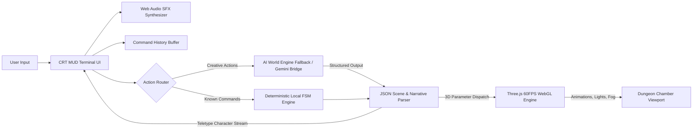

# Technical Design: Text-MUD 3D (Frankenstein Track)

> **LEGACY (v1 prototype).** Describes the original dungeon/mage design. Current game rules and the AI ordering rules are in `dinosaur-survival-spec.md` (sections 6-8). Rewrite pending (tasks.md item 21).

## 1. Architecture & Pipeline



## 2. Component Specifications

### 2.1 Audio Synthesizer (`playKeyClick`, `playSpellSound`)
```typescript
interface AudioEngine {
  playKeyClick(char?: string): void; // Triangle wave 300-500Hz, 40ms envelope
  playThudSound(): void;             // Low sine thump 80-40Hz, 120ms
  playSpellChime(): void;            // Dual sine chime 880Hz + 1320Hz with decay
}
```

### 2.2 Command History Buffer (`HistoryBuffer`)
```typescript
interface HistoryBuffer {
  history: string[];
  cursor: number;
  push(cmd: string): void;
  getPrevious(): string; // Triggered by ArrowUp
  getNext(): string;     // Triggered by ArrowDown
}
```

### 2.3 Character 3D Rig & 4-State Animator (`CharacterRig`)
```typescript
type CharacterAnimationState = 'IDLE' | 'WALK' | 'INTERACT' | 'CAST';

interface CharacterRig {
  group: THREE.Group;
  currentAnim: CharacterAnimationState;
  update(delta: number, elapsed: number): void;
  setAnimation(anim: CharacterAnimationState): void;
}
```
- **Mesh Structure**:
  - `body`: Dark hooded robe (Cylinder + Cone skirt)
  - `head`: Glowing spectral face (Sphere with emissive material)
  - `staff`: Arcane wooden staff with floating energy gem at top
  - `hands`: Low-poly floating hands for cast and interact gestures

### 2.4 Dungeon Chamber Environment (`DungeonChamber`)
```typescript
interface ChamberAtmosphere {
  pointLight: THREE.PointLight;
  ambientLight: THREE.AmbientLight;
  fog: THREE.FogExp2;
  obelisk: THREE.Mesh;
  targetLightColor: THREE.Color;
  targetFogDensity: number;
  cameraShakeIntensity: number;
  update(delta: number, elapsed: number): void;
  applyTransition(params: Partial<ThreeSceneParameters>): void;
}
```
- **Lighting Palette (Strict Authentic Dungeon)**:
  - Default Torch: `0xff7700` (Warm amber flame, 2.2 intensity with LFO flicker)
  - Darkened/Unknown: `0x773311` (Dim smoldering ember, heavy deep shadows)
  - Incandescent Flame: `0xff2200` (Roaring fire red)
  - Spectral Shockwave: `0x00ffcc` (Ancient icy cyan)
  - Blood Curse: `0x880011` (Deep dark crimson, thick smoke)

### 2.5 Hybrid Action Router & Parser (`ActionRouter`)
```typescript
interface ActionRouter {
  dispatch(cmdText: string): Promise<WorldActionResult>;
}

interface WorldActionResult {
  narrativeText: string;
  scene3D: {
    characterAnimation: CharacterAnimationState;
    lightColor: string;
    fogDensity: number;
    cameraShake?: boolean;
    lightIntensity?: number;
  };
}
```

## 이전 버전 기록

- v1은 던전/마법사 프로토타입이었고, 그 다음 단계(v1.5)는 3개 방(로비, 연구실, 관제실)으로 구성된 공룡 생존 MUD였다. 이 기록은 이력이며 현재 규칙이 아니다.

## 현재 5개 방 구성 (요약)

- 로비(Visitor Center Lobby)에서 북쪽(N)은 관제실(Main Control Room), 동쪽(E)은 연구실(Genetics Laboratory), 서쪽(W)은 랩터 우리(Raptor Pen)다.
- 관제실에서 동쪽(E)은 발전소(Geothermal Generator)다.
- 자세한 규칙은 dinosaur-survival-spec.md를 따른다.
