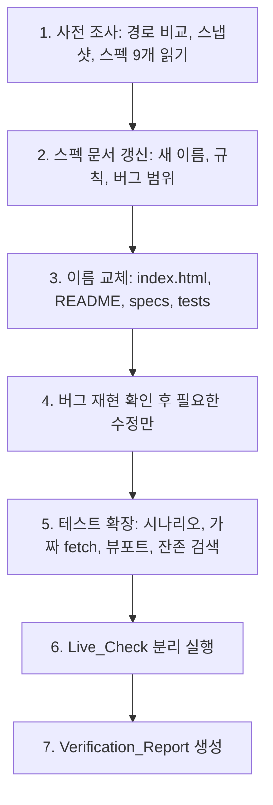
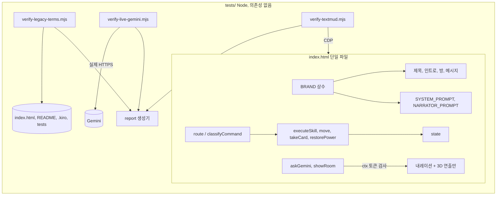

# Design Document

## Overview

이 문서는 `requirements.md`(요구사항 1~17)를 구현하기 위한 기술 설계이다. 게임은 단일 파일 `index.html`(약 1,420줄, Three.js r128 CDN, Web Audio, Canvas 없이 DOM 터미널)이며, 테스트는 `tests/verify-textmud.mjs`(가짜 fetch + 헤드리스 Edge/Chrome, CDP)와 `tests/verify-live-gemini.mjs`(실제 API, 수동)로 구성된다. 새 npm 의존성은 추가하지 않는다(프로젝트 steering 규칙).

### 조사 결과 (코드 확인 사실)

현재 `index.html`과 테스트를 읽고 확인한 내용이다. 확인하지 못한 항목은 따로 적는다.

| 항목 | 현재 코드 상태 | 설계상 의미 |
| --- | --- | --- |
| 테이저 스턴 (R7) | `freshState()`에 `stunRecovery`가 있고, `executeSkill`이 `stunned = type==='shock' && raptorHp>0 && !stunRecovery`, `state.stunRecovery = stunned`로 처리한다. `STUN_SECONDS = 1.2`. | 규칙은 이미 구현됨. 신규 구현이 아니라 R7.1~7.6 시나리오 재현 확인 후 부족분만 수정. |
| 늦은 AI 응답 (R8) | `captureAiContext()`가 `{epoch, roomVisit}`를 반환하고 `isAiContextCurrent()`가 종료 상태까지 검사한다. `aiReqSeq`, `aiAppliedSeq`, `narrationSeq`가 있다. | 요청 순번은 토큰에 포함되지 않고 별도로 비교됨. R8.1 문구에 맞춰 토큰에 순번을 넣도록 정리한다. |
| 기본 정보 우선 (R9) | `showRoom()`이 `describeRoom()`을 먼저 `say`하고, 키가 있으면 `narrateRoomWithGemini()`를 비동기로 붙인다. | 구조는 충족. 단 `GEMINI_TIMEOUT_MS = 12000`이라 R9의 10초와 다르다. 2,000자 상한 검사는 `sanitizeNarration`의 420자 절단으로 대체되어 있어 명시적 검사 추가가 필요 없는지 확인한다. |
| 카드 명령 (R4.5, 4.6) | `route()`의 정규식이 이전 회사 이름 접두어를 선택 항목으로 허용한다. | 이전 회사 이름 접두어를 제거하면 이전 회사 이름이 들어간 카드 명령이 자동으로 알 수 없는 명령이 된다. |
| 로컬 저장소 키 | `GEMINI_API_KEY` 하나. 옛 명칭 아님. | R4.8의 예외 키는 0개. R4.9 기록은 "예외 없음"으로 보고. |
| 옛 명칭 잔존 | `index.html`(`<title>`, 헤더, `ROOMS`, `roomFacts`, `takeCard`, `restorePower`, 인벤토리, 도움말, 인트로, `SYSTEM_PROMPT`, `NARRATOR_PROMPT`, 주석), `README.md`, `.kiro/specs/*.md`, `tests/verify-textmud.mjs`의 헤더 주석. | 단계 3에서 일괄 교체. |
| 탭 제목 | `<title>`에 "(Frankenstein Track)" 접미사가 있다. | R3.1은 정확히 "Dinosaur Survival MUD 3D"를 요구하므로 접미사를 제거한다. README의 Frankenstein 설명은 그대로 둔다(옛 명칭 아님). |
| 테스트 훅 | `window.__mud`가 `executeCmd`, `getState`, `transcript`, `scene3D`, `setRng` 등을 노출한다. | 새 순수 함수와 `BRAND`를 같은 훅에 추가한다. |

확인하지 못한 항목: 실제 디스플레이 렌더링, 오디오 청취, 실제 Gemini 응답 내용(이전 시도는 HTTP 402). 이들은 보고서에서 "미검증"으로 남는다.

### 설계 원칙

1. 기존 동작 보존. 리브랜딩은 문자열 교체이고, 로직 변경은 R4.5/4.6(카드 정규식), R9 타임아웃, R8 토큰 정리로 한정한다.
2. 순수 함수 우선. 문자열 검사, 명령 분류, 전투 턴 판정, AI 응답 적용 판정, 보고서 생성은 부작용 없는 함수로 분리해 속성 기반 테스트가 가능하게 한다.
3. 재현이 먼저. 버그 1~4는 현재 코드에서 시나리오를 실행해 재현되지 않으면 코드를 건드리지 않고 기록만 한다(R7.7).
4. 안전. 보고서와 로그에는 키 값과 응답 본문을 쓰지 않는다. `git commit/push`, 파괴적 git 명령, 외부 게시는 하지 않는다(R16).

## Architecture

작업은 "문서 먼저, 코드 다음, 검증 마지막" 순서의 파이프라인이다.





### 주요 설계 결정과 근거

- **BRAND 단일 정의**: `index.html` 스크립트 맨 위에 `const BRAND = { title, island, company, card, adminLogin }`을 둔다. 방, 인트로, 승리 문구, 프롬프트는 이 값을 템플릿으로 조합한다. `<title>`과 헤더는 정적 HTML에도 같은 리터럴을 두되(스크립트 실행 전 깜빡임과 JS 비활성 상태 대비), 부팅 시 `BRAND`로 덮어쓰고 테스트가 두 값의 일치를 검사한다. 정적 리터럴은 "정의 위치 1곳"의 유일한 예외이며 테스트가 드리프트를 막는다. README는 문서이므로 리터럴을 쓰고, 일치 검사는 R11.8의 대소문자 구분 검색이 맡는다.
- **옛 명칭 목록은 데이터 파일**: `tests/legacy-terms.json`에 목록을 두고 검사 스크립트가 읽는다. 이 파일과 본 스펙 폴더 문서는 용어 자체를 담으므로 허용 목록에 올린다.
- **허용 목록은 파일+줄이 아니라 파일+이유**: 줄 번호는 편집으로 바뀌어 쉽게 깨진다. 항목은 `{path, reason, lines?}`이고, 보고서에는 발견된 실제 줄 번호를 기록한다(R5.4, R11.5). 이름이 옛 작품을 포함하는 변경 이력 문장은 "이전 이름" 문구를 필수로 한다.
- **스펙 파일 이름 변경**: 이전 스펙 파일을 `dinosaur-survival-spec.md`로 바꾸고, `README.md`와 `.kiro/specs/` 안의 참조를 모두 갱신한다. 파일 시스템 이름 변경만 사용하며 git 파괴 명령은 쓰지 않는다.
- **가짜 fetch와 실제 호출 분리**: 기존 구조를 유지한다. `verify-textmud.mjs`는 네트워크 0건, `verify-live-gemini.mjs`는 키가 있을 때만 최대 3회 호출한다.
- **보고서 생성기는 별도 순수 함수**: 결과 객체를 받아 17개 항목을 모두 채운 마크다운을 반환한다. 입력이 없는 항목은 "미검증"으로 채워 누락이 불가능하게 한다(R17.8).

## Components and Interfaces

### C1. 사전 조사 절차 (R1, R2)

코드가 아닌 실행 절차이며 결과는 보고서 1절에 기록한다.

1. 두 경로(`c:\AI\projects\kiroween-textmud-3d`, `C:\AI\projects\kiroween-textmud-3d`)에 대해 `Resolve-Path`, `(Get-Item).LinkType`, `git rev-parse --show-toplevel`을 실행한다. 둘 다 같으면 "동일 저장소"와 근거 값을 기록하고, 다르면 `git status --porcelain`과 `git diff`를 파일별로 비교한다. 명령 실패 시 파일 수정 없이 중단.
2. Working_Tree_Snapshot: `$env:TEMP\mud-snapshot-<timestamp>\`에 `status.txt`(`git status --porcelain`), `tracked.patch`(`git diff`), `untracked\`(미추적 파일 사본)를 만든다. 사본 파일 수와 `status.txt` 변경 항목 수가 일치하지 않으면 중단. 추적 파일은 `git diff` 패치로 보존되므로 항목 수 비교는 "추적 변경 파일 수(패치 내 `diff --git` 개수) + 미추적 사본 수"로 한다.
3. 스펙 9개(README + 8개 문서)와 `.kiro/steering/project.md`를 읽고 파일명을 기록한다. 하나라도 없으면 중단.
4. 수정 전후 `git diff` 해시 비교로, 수정 대상이 아닌 줄이 유지됨을 확인한다(R1.9).

금지 명령(R1.8)은 절차 문서에 명시하고, 실행 스크립트에는 넣지 않는다.

### C2. 브랜드 정의 (R3, R4)

```js
const BRAND = Object.freeze({
  title:   'Dinosaur Survival MUD 3D',
  island:  'Ashfen Island',
  company: 'Calderyn Biosciences',
  card:    'Calderyn Security Passcard',
  adminLogin: 'calderyn_admin'   // company에서 파생
});
```

교체 매핑(의미 유지, 원문과 4단어 이상 연속 일치 금지):

| 위치 | 현재 | 교체 |
| --- | --- | --- |
| 탭 제목 / 헤더 | 이전 영화 기반 게임 제목과 이전 섬 이름을 쓴 제목 / 같은 이름을 대문자로 쓴 헤더 | `BRAND.title` / `BRAND.title.toUpperCase() + ' :: ' + BRAND.island.toUpperCase()` |
| 인트로 | 이전 회사 이름과 이전 섬 이름을 쓴 메인프레임 인트로 | `CALDERYN MAINFRAME :: ASHFEN ISLAND SURVIVAL MUD v1.0` (`BRAND` 조합) |
| 카드 문구(방, 획득, 인벤토리, 거부) | 이전 회사 이름이 들어간 카드 이름과 카드 문구 | `BRAND.card` / "the Calderyn passcard" 형태로 `BRAND.company` 파생 |
| 로그인 | 이전 관리자 로그인 이름 | `login: ` + `BRAND.adminLogin` |
| 대사 | 원작 영화 대사 | 예: `Kernel check passed. Every relay answers.` (연속 일치 단어 0개) |
| 승리 | 이전 섬 이름이 들어간 원작식 승리 문구 | 예: `Ashfen Island hums back to life as the grid comes online.` (원문과 연속 일치 3단어 이하) |
| 프롬프트 | 이전 영화 기반 게임 제목과 이전 섬 이름을 쓴 시스템 프롬프트, 내레이터 프롬프트 | `BRAND.title`, `BRAND.island`, `BRAND.company`를 각 1회 이상 포함한 문장 |
| 주석 | 이전 영화 이름이 들어간 디오라마 주석 등 | "Dinosaur Dioramas" 등 |

방 이름 5개(Visitor Center Lobby, Genetics Laboratory, Main Control Room, Raptor Pen, Geothermal Generator)와 수치(HP 100, 샷건 3발, 조명탄 2, 테이저 3, 랩터 HP 45, 반격 8~17)는 변경하지 않는다.

테스트 훅 `window.__mud`에 `BRAND`, `ROOMS`(읽기 전용 사본), `classifyCommand`를 추가한다.

### C3. 명령 분류 순수 함수 (R4.5, R4.6)

`route()` 내부의 정규식 판정을 `classifyCommand(raw) -> {type, arg?}`로 분리한다. `type`은 `RESTART | MOVE | SHOOT | SHOCK | FLARE | LOOK | TAKE_CARD | RESTORE | INVENTORY | STATUS | HELP | FREE_TEXT`. 카드 정규식은 `/^(take|get|grab|pick up) (the )?(security )?(pass ?card|card)$/`로 바꾼다. 이전 회사 이름이 들어간 카드 명령은 매칭하지 않아 `FREE_TEXT`가 되고, 키가 없으면 기존 알 수 없는 명령 힌트가, 키가 있으면 AI 월드 엔진이 처리한다. 요구사항 4.6은 "알 수 없는 명령에 대한 응답"을 요구하므로 테스트는 키가 없는 상태에서 힌트 문구를 확인한다.

`route()`는 `classifyCommand` 결과로 분기만 한다. 분기 순서는 기존과 동일하다.

### C4. 전투 턴 판정 (R7)

`executeSkill`의 스턴 계산을 순수 함수로 추출한다.

```js
// 입력: { type, raptorHp(피해 적용 후), blind, stunRecovery, taserCharges }
// 출력: { stunned, nextStunRecovery, counterAllowed }
function resolveStunTurn(i) { ... }
```

규칙: `shock`이고 피해 후 `raptorHp>0`이고 `!stunRecovery`이면 `stunned=true`, 그 외 `false`. `nextStunRecovery = stunned`. 이 한 줄 대입이 모든 전투 행동에 적용되므로 R7.2(회복 턴의 다음 행동 후 해제)가 자동으로 충족된다. 치명 타격은 `raptorHp<=0`이라 스턴이 없고 반격도 없다(R7.3). 충전량 0이면 함수 호출 이전에 `executeSkill`이 실패 메시지 1회를 내고 반환하며 상태를 바꾸지 않는다(R7.4, 현재 코드에서 재확인). `restartGame`과 `gameOver`는 `stunRecovery=false`를 보장한다(`freshState()` 재생성, 게임 오버 시 별도 초기화 여부를 재현 확인).

로그는 스턴 시 1줄, 시각 효과는 `STUN_SECONDS`(1.2, 허용 1.0~1.4)다.

### C5. AI 문맥 토큰과 응답 적용 판정 (R8, R9)

```js
// 요청 시점에 저장
function captureAiContext(kind) { return { epoch, roomVisit, seq: ++aiReqSeq, kind }; }
// 순수 판정
function shouldApplyAiReply(ctx, cur) {
  return !!ctx && ctx.epoch === cur.epoch && ctx.roomVisit === cur.roomVisit &&
         !cur.over && !cur.won && ctx.seq >= cur.appliedSeq;
}
```

`cur`는 `{epoch, roomVisit, over, won, appliedSeq}` 스냅샷이다. 적용되면 `appliedSeq = ctx.seq`로 갱신한다. `restartGame`은 `appliedSeq = aiReqSeq`로 올려 이전 요청을 모두 무효화한다(현재 코드와 동일). 방 내레이션(`showRoom`)은 별도 `narrationSeq`로 같은 방에서 더 새로운 `look`이 이전 응답을 가리는 것을 막고, 두 검사를 모두 통과해야 출력한다. 폐기 시에는 오류 메시지, 로그, 3D, 게임 상태에 어떤 변경도 하지 않는다(R8.8).

`applyWorldMutation`은 `narrativeText`와 `scene3D`(조명, 안개, 애니메이션, 카메라 흔들림)만 다루며 `state`를 쓰지 않는다(R8.6). 이 불변식은 속성으로 검증한다.

타임아웃은 `GEMINI_TIMEOUT_MS = 10000`으로 낮춘다(R9.2의 10초 상한과 일치). 내레이션은 `sanitizeNarration`을 거쳐 공백 제외 1자 이상, 2,000자 이하일 때만 출력하고, 그 외에는 아무것도 출력하지 않는다.

### C6. 옛 명칭 검사기 (R5, R11)

`tests/verify-legacy-terms.mjs`(Node 내장 모듈만 사용).

```js
// 순수: 텍스트에서 모든 일치를 반환 (대소문자 무시)
export function scanLegacyTerms(text, terms) -> Array<{line:number, term:string}>
// 파일 단위 실행: 대상 = index.html, README.md, .kiro/**, tests/**
export function scanFiles(root, terms, allowlist) -> {scannedCount, hits, allowed, unresolved}
```

- 용어 목록은 `tests/legacy-terms.json`(task 6.1에서 생성). 목록에는 이전 영화 기반 게임 제목, 이전 섬 이름, 이전 회사 이름, 이전 관리자 로그인 이름, 원작 영화 대사가 들어간다. 짧은 이전 회사 이름은 다른 단어 중간에 일치할 수 있으므로 단어 경계 규칙을 쓴다(로그인 이름은 별도 항목).
- 허용 목록 `legacy-allowlist.json`: `tests/legacy-terms.json` 자신, 본 스펙 폴더의 `requirements.md`와 `design.md`(용어 정의 목적), 그리고 변경 이력 문장 항목. 허용 항목은 보고서에 별도 분류로 나온다.
- 바이너리나 이미지(`*.png`, `*.jpg`, `*.mp4`)는 텍스트 검색 대상에서 제외하고 경로를 "미검증 범위"로 나열한다(R11.7). 현재 저장소에는 `.git`을 제외하면 확인된 이미지가 없으며 README의 YouTube 썸네일은 외부 URL이다.
- 종료 코드: 미해결 0건이면 0, 아니면 1.

### C7. 테스트 스위트 확장 (R12, R13, R15)

`verify-textmud.mjs`에 구역을 추가한다.

1. 이동: 모든 간선과 복귀 간선을 실행해 `getState().room` 확인. 랩터가 살아 있는 로비에서는 이동 시 피해가 나므로 먼저 `executeSkill`로 처치하거나 rng를 고정한다.
2. 자원: `shoot/shock/flare` 각각의 탄약, 충전량, 조명탄 변화량.
3. 승리: 카드 획득, 관제실 승리, 발전소 승리를 별도 `fresh()` 호출로 분리.
4. 게임 오버 후 `restart`: 초기값 일치.
5. 이름: 제목, 인트로, 모든 방 설명(`describeRoom` 출력), 카드 문구, 승리 문구에 `BRAND` 값이 하나 이상 있고 옛 용어가 0건.
6. 스턴: 교대, 회복 턴, 치명 타격, 빈 테이저를 별도 케이스로.
7. 콘솔 오류 0건.
8. 브라우저 없음: 시나리오 실행 전에 코드 2로 종료(현재 구현됨).
9. 실패 출력: 시나리오 이름, 기대값, 실제값, 종료 코드 1(현재 `check`가 부분 지원).
10. AI(가짜 fetch): 기존 `__pending` 보류/수동 해제 방식 유지. 방 이동 후 늦은 응답, 재시작/게임 오버/승리 후 응답, 역순 응답, HTTP 오류, 예외, 잘못된 JSON, 10초 무응답(가짜 타이머가 아니라 `fetch`가 `AbortSignal`을 받아 reject하도록 하고 `GEMINI_TIMEOUT_MS`를 훅으로 낮춰 실제 대기를 피한다), `look` 순서 검사.
11. 뷰포트: CDP `Emulation.setDeviceMetricsOverride`로 1920x1080, 1280x720을 설정하고 각 요소(`header`, 인트로 첫 로그 노드, 가장 긴 방 설명을 `say`한 노드, `.chip` 전체, `#mud-input`)의 `getBoundingClientRect()`가 0 이상 뷰포트 이하인지, `#log`와 터미널 컨테이너의 `scrollWidth <= clientWidth`인지 확인한다. 실패하면 해상도와 요소 이름을 출력한다.

가장 긴 방 설명은 `ROOMS`를 훅으로 읽어 `describeRoom()` 길이로 선택한다.

### C8. Live_Check (R14)

기존 `verify-live-gemini.mjs`를 유지한다. 키 없음이면 코드 3으로 종료하며 보고서 항목을 "미검증(키 없음)"으로 채운다. 호출은 최대 3회, 30초 타임아웃, HTTP 상태, 응답 길이, 형태만 기록한다. 응답에 옛 명칭이 있는지의 확인은 스크립트 안에서 `scanLegacyTerms`로 하고, 일치 여부(예/아니오)만 보고하며 본문은 출력하지 않는다. HTTP 200이 아니면 "미검증"과 상태 코드를 기록하고 보고서를 계속 생성한다.

### C9. 보고서 생성기 (R14, R15, R17)

`tests/build-report.mjs`가 각 스크립트가 남긴 JSON 결과(`tests/.results/*.json`, 커밋 대상 아님)를 읽어 `.kiro/specs/dinosaur-survival-mud-rebrand/verification-report.md`를 쓴다.

```js
export function buildReport(results) -> string
```

- 필수 17개 기능 이름을 상수 배열로 가지며, 각 항목에 상태 `검증됨 | 부분 검증 | 미검증 | 실패` 중 정확히 하나와 500자 이하 근거를 쓴다.
- 결과가 없는 항목은 "미검증"과 누락 사유로 채운다.
- 오디오와 실제 디스플레이 렌더링은 자동화 결과만으로는 "검증됨"이 될 수 없다. 사람 확인 입력이 없으면 "미검증"으로 고정한다(R17.4).
- Fake_Fetch 절과 Live_Check 절을 분리해 통과/실패 건수를 따로 표시한다. 실제 AI 연동 성공은 Live_Check가 HTTP 200일 때만 인정한다.
- "프로젝트 소유자 확인 필요" 잔여 항목: 상표 검토, 저작권 검토, 설정 유사성, Existing_Demo_Video 교체.
- 데모 재녹화 순서(R15.1~15.3): 사전 점검(키 입력란 `type="password"` 또는 오프라인 확인), 제목 화면 5초, 인트로 8초, 로비 전투(shoot, shock, flare 각 1회 이상) 20초, 연구실 이동과 카드 획득 12초, 관제실 이동과 `restore power` 승리 15초, `restart` 5초 = 65초. 합계가 60~90초인지 생성기가 검사한다. 로비 전투는 랩터가 살아 있으므로 이동 피해를 고려해 처치 후 이동하는 명령 순서를 쓴다.

### C10. 문서 갱신 (R2, R5, R10)

- `.kiro/specs/` 기존 문서는 삭제 없이 해당 절을 갱신하고 갱신 절 제목을 보고서에 기록한다.
- `requirements.md`/`design.md`(v1, LEGACY)는 최상단 LEGACY 표시를 유지하고, 3개 방 설명을 "이전 버전 기록" 구획으로 옮겨 5개 방 기준 본문을 추가한다.
- `tasks.md`: 리브랜딩 작업을 기존 번호(현재 19번까지)를 잇는 번호로 추가하고, 중복 항목은 "병합 이력" 구획에 기록한다. `[x]`는 검증 명령 실행 후에만 표시하고, 미구현 항목(`HistoryBuffer` 등)은 `[ ]`와 "미구현" 문구를 쓴다.
- README: 제목, 소개, 명령어, 이미지 대체 텍스트(`Demo` 링크 alt)를 교체한다. 데모 링크(`youtu.be/4YOpwRZm5aE`) 문자열은 유지하고, 링크 전후 1문장 이내에 "Existing_Demo_Video는 이전 게임을 녹화한 영상이며 이번 코드 변경으로 바뀌지 않았다"는 취지의 문구를 넣는다. 저장소 URL과 Devpost 항목은 그대로 둔다.
- 참조 검사: `README.md`와 `.kiro/specs/`의 마크다운 링크와 백틱 경로를 추출해 로컬 파일 존재를 확인한다(스펙 파일명 변경 후 깨진 참조 방지, R5.7).

## Data Models

### 런타임 상태 (`index.html`, 기존 필드 유지)

```js
state = {
  room: 'lobby'|'lab'|'control'|'pen'|'generator',
  hp: number, shells: number, flares: number, taserCharges: number,
  hasCard: boolean, raptorHp: number, raptorsAlive: boolean,
  over: boolean, won: boolean, shotsFired: number, shocksUsed: number,
  stunRecovery: boolean
}
// 모듈 변수: epoch, roomVisit, aiReqSeq, aiAppliedSeq, narrationSeq
// AI 문맥 토큰: { epoch, roomVisit, seq, kind: 'world'|'narr' }
```

변경은 토큰에 `seq`/`kind`를 더하는 것 하나뿐이다. `state`의 필드와 초기값은 바꾸지 않는다(R6.8).

### 방 그래프 (변경 없음)

`lobby -N-> control`, `lobby -E-> lab`, `lobby -W-> pen`, `control -E-> generator`, 각 방에서 반대 방향 복귀.

### 검사 데이터

```jsonc
// tests/legacy-terms.json
{ "terms": ["<이전 영화 기반 게임 제목>", "<이전 섬 이름>", "<이전 회사 이름>", "<이전 관리자 로그인 이름>", "<원작 영화 대사>"],
  "wordBoundary": ["<이전 회사 이름>"] }

// tests/legacy-allowlist.json
{ "entries": [ { "path": "tests/legacy-terms.json", "reason": "용어 정의" },
               { "path": ".kiro/specs/dinosaur-survival-mud-rebrand/requirements.md", "reason": "용어 정의" },
               { "path": ".kiro/specs/dinosaur-survival-mud-rebrand/design.md", "reason": "용어 정의" } ] }
```

### 검증 결과와 보고서

```jsonc
// tests/.results/<suite>.json
{ "suite": "fake-fetch"|"legacy-scan"|"live"|"layout",
  "env": { "browser": "string", "viewport": "1920x1080" },
  "cases": [ { "feature": "string", "name": "string", "status": "pass"|"fail"|"skipped", "detail": "string" } ] }
// 보고서 항목
{ "feature": "string", "status": "검증됨"|"부분 검증"|"미검증"|"실패", "evidence": "<=500자", "command": "string|해당 없음", "env": "string", "result": "string" }
```

## Correctness Properties

*A property is a characteristic or behavior that should hold true across all valid executions of a system-essentially, a formal statement about what the system should do. Properties serve as the bridge between human-readable specifications and machine-verifiable correctness guarantees.*

속성 반영(reflection) 결과: 카드 중복 획득과 `restore power` 거부, 빈 테이저는 모두 "거부된 행동은 상태를 바꾸지 않는다"로 묶었다. 이름/프롬프트/문서 검사는 `scanLegacyTerms` 하나로 통합했다. 방 이동, 제목, 순서 검사 등 입력 변화가 의미 없는 항목은 예제 테스트로 둔다.

### Property 1: 옛 명칭 검사기의 완전성과 정확성

*For any* 텍스트와 옛 명칭 목록, 목록의 한 용어를 임의의 대소문자 조합으로 임의 위치에 삽입하면 `scanLegacyTerms`는 삽입 위치의 줄 번호와 해당 용어를 보고해야 하고, 어떤 용어도 포함하지 않는 텍스트에는 0건을 보고해야 한다.

**Validates: Requirements 3.4, 4.1, 4.7, 4.8, 5.1, 5.2, 11.1, 11.2, 11.3**

### Property 2: 카드 획득 명령 분류

*For any* 대소문자와 공백 변형을 가한 `take|get|grab|pick up` + (선택적 `the`) + (선택적 `security`) + `card|passcard|pass card` 문자열, `classifyCommand`는 `TAKE_CARD`를 반환해야 하고, 이전 회사 이름을 포함한 같은 형태의 문자열은 `TAKE_CARD`를 반환하면 안 된다.

**Validates: Requirements 4.5, 4.6**

### Property 3: 거부된 행동은 게임 상태를 바꾸지 않는다

*For any* 게임 상태와 다음 중 하나의 거부 조건 행동, 즉 카드가 없는 `restore power`, 관제실/발전소 밖에서의 `restore power`, 테이저 충전량 0에서의 `shock`, 이미 카드를 가진 상태의 `take card`, 행동 실행 후 `state`는 실행 전과 깊은 동등해야 한다(카드 중복 획득의 경우 카드 보유가 `true`로 유지되고 개수가 늘지 않는다).

**Validates: Requirements 6.3, 6.5, 6.6, 7.4**

### Property 4: 스턴 상태 기계

*For any* 전투 행동 시퀀스(`shoot|shock|flare`)와 임의의 피해 굴림, 참조 모델과 비교했을 때 다음이 성립해야 한다: `shock`이 피해 후 랩터 체력을 0 초과로 남기고 스턴 회복 상태가 아니면 반격이 0이고 회복 상태가 켜진다. 회복 상태에서의 다음 전투 행동은 일반 규칙으로 처리되고(`shock`이어도 스턴 없음, 정상 반격) 처리 직후 회복 상태가 꺼진다. 체력을 0 이하로 만드는 `shock`은 스턴 없이 반격 0으로 처치된다.

**Validates: Requirements 7.1, 7.2, 7.3**

### Property 5: AI 응답 적용 판정

*For any* 요청 문맥 토큰 `{epoch, roomVisit, seq}`와 현재 상태 `{epoch, roomVisit, over, won, appliedSeq}`, `shouldApplyAiReply`는 세 값이 모두 같고, 게임이 끝나지 않았고, `seq`가 이미 적용된 순번보다 작지 않을 때에만 `true`를 반환해야 한다.

**Validates: Requirements 8.1, 8.2, 8.3, 8.4, 8.5, 8.7, 9.7**

### Property 6: AI 응답은 게임 규칙 상태를 바꾸지 않는다

*For any* 형식이 유효한 임의의 월드 엔진 응답 JSON(`sanitizeWorldData`를 통과한 값), `applyWorldMutation` 적용 전후로 `hp`, `shells`, `flares`, `taserCharges`, `hasCard`, `room`, `won`, `over`, `raptorHp`는 동일해야 한다.

**Validates: Requirements 8.6, 9.4**

### Property 7: 내레이션 정제는 평문과 길이 상한을 보장한다

*For any* 문자열 입력, `sanitizeNarration`의 결과는 마크다운 기호(`*`, `_`, `#`, `` ` ``, `>`)와 코드 펜스를 포함하지 않고, 길이가 2,000자 이하이며, 입력이 공백뿐이거나 문자열이 아니면 빈 문자열이다.

**Validates: Requirements 9.2, 9.3**

### Property 8: 키 값 가림

*For any* 출력 문자열과 비어 있지 않은 키 값, `scrub(text, key)`의 결과는 키 값을 부분 문자열로 포함하지 않아야 한다.

**Validates: Requirements 14.3, 16.6, 16.7**

### Property 9: 보고서 완전성

*For any* 부분적이거나 비어 있는 검증 결과 입력, `buildReport`가 만든 보고서는 필수 17개 기능을 모두 포함하고, 각 항목은 허용된 4개 상태 중 정확히 하나와 500자 이하 근거를 가지며, 사람 확인 입력이 없는 오디오와 실제 디스플레이 렌더링 항목은 "검증됨"이 아니어야 한다.

**Validates: Requirements 17.1, 17.2, 17.4, 17.6, 17.8**

## Error Handling

- **사전 조사 실패**: 경로 부재, git 아님, 명령 실패, 스냅샷 생성 실패, 파일 수 불일치, 스펙 문서 누락 시 파일을 수정하지 않고 사유를 보고서에 쓴 뒤 중단한다(R1.2, 1.6, 2.7).
- **미커밋 변경 충돌**: 충돌 파일, 줄 범위, 처리 방법을 기록하고, 충돌 없는 변경은 수정 전후 `git diff` 비교로 동일함을 확인한다(R1.9). 충돌 해결에 되돌리기 명령은 쓰지 않는다.
- **AI 실패 일체(HTTP 오류, 예외, 잘못된 JSON, 10초 초과, 빈 응답, 2,000자 초과)**: `geminiGenerate`는 항상 `null`을 반환하며 reject하지 않는다. 방 내레이션은 아무것도 출력하지 않고, 자유 입력은 기존 오프라인 힌트를 출력한다. 폐기된 응답은 조용히 버린다. 콘솔에는 `console.warn`만 남기고 `console.error`는 쓰지 않아 R12.7의 콘솔 오류 0건 조건과 충돌하지 않는다.
- **Live_Check**: 키 없음(코드 3), 비 200, 타임아웃, 네트워크 오류 모두 프로세스를 중단하지 않고 "미검증"과 사유(상태 코드 또는 오류 종류)를 결과 파일에 남긴다. 키와 본문은 `scrub`을 거치기 전에는 어떤 출력에도 쓰지 않는다.
- **테스트 환경**: 브라우저를 찾지 못하면 시나리오 실행 전 코드 2로 종료한다. CDP 연결 실패는 60회 재시도 후 실패로 보고한다. 프로필 임시 폴더는 `finally`에서 삭제한다.
- **웹 검색 실패(R3.7)**: 해당 이름을 "미확인"으로 기록하고 검증 완료로 표시하지 않는다. 법적 판단은 소유자 확인 항목으로 남긴다.
- **게임 코드**: `executeCmd`의 기존 try/catch를 유지한다. 새 순수 함수는 입력이 이상해도 예외 없이 안전한 기본값을 반환한다(steering의 "예외로 중단하지 않는다" 규칙).
- **범위 제한(R16)**: `git commit`, `git push`, 원격 브랜치/PR, 유튜브 및 Devpost 변경은 실행하지 않고 보고만 한다. API 키와 `.env`는 파일에 기록하지 않는다.

## Testing Strategy

### 접근 방식

예제 테스트와 속성 기반 테스트를 함께 쓴다. 단위/예제 테스트는 구체적 시나리오(방 이동, 승리, 재시작, 가짜 fetch 시나리오, 뷰포트)에, 속성 테스트는 순수 함수(Property 1~9)에 쓴다. 3D 렌더링, 오디오, 레이아웃은 PBT 대상이 아니며 스냅샷/수치 검사나 사람 확인으로 다룬다. 실제 Gemini 호출은 통합 검증이며 1~3회만 수행한다.

### 속성 기반 테스트 구성

- 라이브러리: `fast-check`를 사용한다(속성 기반 테스트를 직접 구현하지 않는다). 설계 결정: 이 패키지는 개발 전용(devDependency, 정확한 버전 고정)이며 `tests/package.json`에만 둔다. 게임 파일 `index.html`의 런타임 의존성은 늘지 않는다. 이는 R6.10의 "새로운 npm 의존성 0개"를 게임 런타임 기준으로 해석한 것이다. 프로젝트 steering은 requirements에 명시되지 않은 의존성을 금지하므로, 이 해석은 구현 단계 시작 시 보고서의 결정 사항에 기록하고 소유자가 이의를 제기하면 속성 테스트를 보류한다. 설치가 불가능하거나 보류되면 속성 항목은 "미실행"으로 보고하고 관련 기능을 "부분 검증"으로 둔다.
- 순수 함수는 `tests/lib/pure.mjs`로 옮기지 않고 `index.html`에 단일 정의를 유지한다. 테스트는 CDP로 페이지 안의 훅(`window.__mud.classifyCommand` 등)을 호출하고, 입력 생성은 Node 쪽 fast-check가 맡는다. 보고서 생성기, 검사기, `scrub`은 Node 모듈이므로 직접 import한다.
- 각 속성 테스트는 최소 100회 반복한다.
- 각 테스트에 태그 주석을 단다. 형식: `Feature: dinosaur-survival-mud-rebrand, Property N: <속성 제목>`.
- 각 속성은 단일 속성 기반 테스트 하나로 구현한다.

### 예제/통합 테스트 매핑

| 요구사항 | 테스트 | 종류 |
| --- | --- | --- |
| R3.1~3.3 | 탭 제목, 헤더, 섬/회사/카드 표시 문자열이 `BRAND`와 일치 | 예제 |
| R4.2~4.4, 4.10 | 로그인 이름, 승리 문구, 대사 교체 연속 일치 단어 수 계산, 방 이름 5개 불변 | 예제 |
| R5.3, 5.5~5.7 | 파일명 변경 후 깨진 참조 0건, 데모 문구와 URL 불변 | 예제 |
| R6.1~6.4, 6.7~6.9 | 이동 간선 전체, 카드/승리 경로, 수치 불변, 방/아이템 추가 없음 | 예제 |
| R7.6 | 스턴 로그 1줄, `STUN_SECONDS`가 1.0~1.4 | 예제 |
| R9.1, 9.5, 9.6 | 지연 응답에서 기본 텍스트가 먼저 출력, 키 없음에서 fetch 호출 0회, 진행 중 명령 즉시 처리 | 예제 |
| R13.1~13.7 | 가짜 fetch 시나리오 전체, 같은 시나리오 2회 연속 실행 결과 일치 | 예제 |
| R14.1~14.7 | 보고서 절 분리, 키 없음/비 200 처리 | 통합 + 예제 |
| R15.1~15.9 | 재녹화 순서 합계 60~90초, 두 해상도 레이아웃 검사 | 예제 |
| R1, R2, R10, R16 | 절차 체크리스트와 `git diff` 비교, `tasks.md` 체크 규칙 | 스모크/수동 |
| R17.3, 17.5 | 보고서 필수 필드와 잔여 항목 존재 | 예제 |

### 검증 순서

1. `node tests/verify-legacy-terms.mjs` : 미해결 0건.
2. `node tests/verify-textmud.mjs` : 전 시나리오와 뷰포트 검사 통과, 콘솔 오류 0건.
3. `node tests/verify-live-gemini.mjs` : 키가 있을 때만. 결과는 가짜 응답 결과와 섞지 않는다.
4. `node tests/build-report.mjs` : 보고서 생성.

### 미검증으로 남는 범위 (사전 선언)

오디오 청취, 실제 디스플레이 렌더링, 실제 Gemini 응답 품질(키 및 결제 상태에 의존), 이미지/영상 속 옛 명칭, 법적 검토, Existing_Demo_Video 교체. 이들은 보고서에서 "미검증" 또는 "프로젝트 소유자 확인 필요"로 표시한다.
